# Как установить «Кладезъ» на компьютер с Windows

Эта инструкция — для всех, в том числе для тех, кто ставит программу сам впервые. Установка занимает **20–40 минут**, из них вы нажимаете кнопки минуты три — остальное время программа работает сама. Один раз компьютер перезагрузится.

> Из этой инструкции потом будет сделана страница сайта и видео. Места для картинок помечены так: **[Картинка: …]**. Где картинка уже есть — она вставлена.

---

## Что нужно

| | Что нужно | Как узнать |
|---|---|---|
| **Windows** | Windows 10 (версия 2004 или новее — то есть 20H2, 21H2, 22H2) или Windows 11. Домашняя (Home) тоже подходит. | «Пуск» → «Параметры» → «Система» → «О программе», строка «Версия». |
| **Память** | 8 ГБ и больше. С 4 ГБ «Кладезъ» работает, но медленно, а ИИ-помощник работать не будет. | Там же, строка «Оперативная память». |
| **Место на диске** | Сама программа — около 10 ГБ. Библиотека — сколько выберете: «Аптечка» около 5 ГБ, «Библиотека» около 26 ГБ, «Всё» — около 62 ГБ. | Откройте «Этот компьютер» — под каждым диском написано, сколько свободно. |
| **Виртуализация** | Должна быть включена. Почти всегда уже включена. | Установщик проверит сам. Если выключена — покажет инструкцию (см. [ниже](#если-установщик-просит-включить-виртуализацию)). |
| **Интернет** | Только чтобы скачать установщик (около 1,5 ГБ), а потом — материалы. Во время установки интернет не нужен. | |
| **Права** | Учётная запись, которой разрешено устанавливать программы (администратор). На домашнем компьютере обычно так и есть. | |

Windows 7 и 8 не подходят.

---

## Шаг 1. Скачайте установщик

Откройте страницу «Кладезя» и скачайте файл **«Кладезъ-установка-…exe»** (около 1,5 ГБ):

**https://github.com/Leon-Kladez/kladez/releases**

Рядом лежит файл **SHA256SUMS.txt** — по нему можно проверить, что файл настоящий (см. [Как проверить, что файл настоящий](#как-проверить-что-файл-настоящий)).

Браузер может сказать, что файл «скачивают редко» или «может быть опасен». Это потому, что программа новая. Нажмите на три точки рядом с файлом в списке загрузок и выберите **«Сохранить»** (в Edge может понадобиться ещё «Показать больше» → «Всё равно сохранить»).

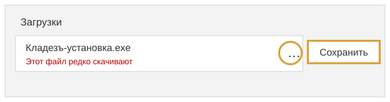

**[Картинка: настоящий снимок списка загрузок Edge с предупреждением]**

## Шаг 2. Запустите установщик — синее окно «Windows защитила ваш компьютер»

Откройте папку **«Загрузки»** и дважды щёлкните **«Кладезъ-установка-…»**.

Скорее всего, появится синее окно **«Windows защитила ваш компьютер»**. Не пугайтесь — так и должно быть.

**Почему так.** Windows показывает это окно для всех программ, у которых нет платной электронной «подписи». Подпись стоит сотни долларов в год, а «Кладезъ» — бесплатная программа, которую делают для людей, а не для заработка. Окно не значит, что в файле вирус: Windows просто ещё не знает этого издателя. Чтобы убедиться, что файл настоящий, сверьте его контрольную сумму (см. [ниже](#как-проверить-что-файл-настоящий)).

Что нажать:

1. Нажмите на слова **«Подробнее»** — они написаны мелко, под текстом.
2. Внизу появится кнопка **«Выполнить в любом случае»** — нажмите её.

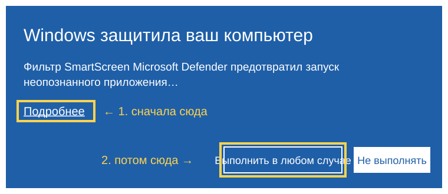

**[Картинка: настоящий снимок синего окна SmartScreen до и после нажатия «Подробнее»]**

## Шаг 3. Разрешите изменения — «Да»

Windows спросит: **«Разрешить этому приложению вносить изменения на вашем устройстве?»** Издатель будет «неизвестно» — по той же причине, что и синее окно. Нажмите **«Да»**.

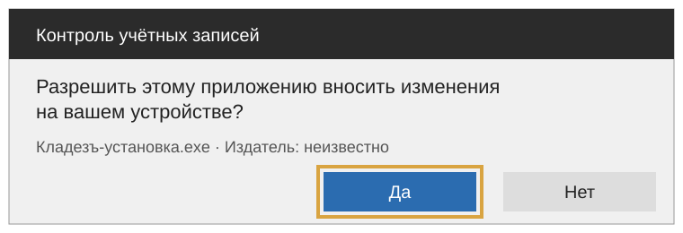

**[Картинка: настоящий снимок окна контроля учётных записей]**

Установщик проверит, подходит ли компьютер. Если что-то не так, он скажет об этом простыми словами и подскажет, что делать.

## Шаг 4. «Информация» — нажмите «Далее»

Откроется окно установщика с коротким рассказом о программе: что она делает, что ничего не скачивается во время установки и что программа ничего не сообщает о вас. Прочитайте и нажмите **«Далее»**.

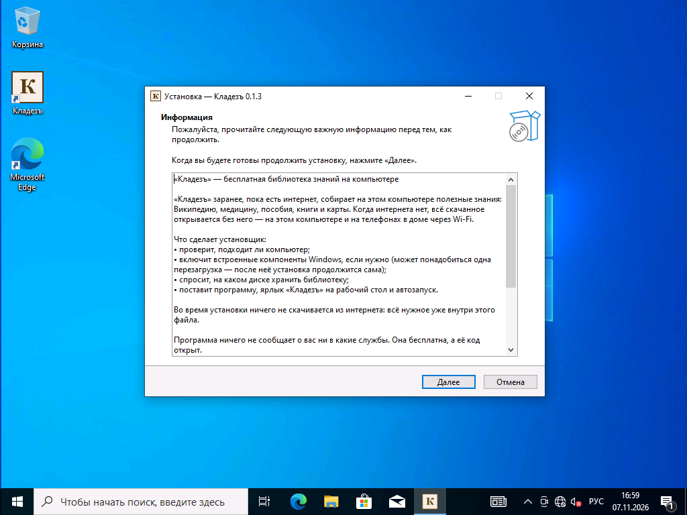

## Шаг 5. Выберите диск для библиотеки

Установщик спросит, **на каком диске хранить библиотеку** — статьи, карты и книги. Рядом с каждым диском написано, какие наборы на нём поместятся: «Аптечка», «Библиотека», «Всё».

Выберите диск, где больше всего места. Если у вас один диск C: — выберите его. Нажмите **«Далее»**.

**[Картинка: страница «Где хранить библиотеку» со списком дисков]**

Библиотека будет лежать в папке `Kladez\library` на этом диске, например `D:\Kladez\library`.

## Шаг 6. Нажмите «Установить»

На странице «Всё готово к установке» нажмите **«Установить»**. Установщик распакует программу и включит нужные компоненты Windows.

**[Картинка: страница «Всё готово к установке» с кнопкой «Установить»]**

## Шаг 7. «Нужна перезагрузка» — нажмите «Завершить»

На большинстве компьютеров Windows нужно один раз перезагрузить, чтобы включились её встроенные компоненты. Установщик скажет: **«Нужна перезагрузка»**.

1. Сохраните открытые документы и закройте другие программы.
2. Нажмите **«Завершить»**. Компьютер перезагрузится сам.

**[Картинка: страница «Нужна перезагрузка» с кнопкой «Завершить»]**

Если перезагрузка не понадобилась, установка просто продолжится — переходите к шагу 9.

## Шаг 8. Войдите в Windows — установка продолжится сама

После перезагрузки войдите в Windows как обычно. Примерно **через полминуты** установщик откроется сам.

- Снова появится окно «Информация» — нажмите **«Далее»**, затем **«Установить»**.
- Дальше установщик работает сам: **«Распаковываю программу. Это займёт 3–7 минут…»**. На медленном компьютере — до 15 минут. Ничего не нажимайте и не выключайте компьютер.

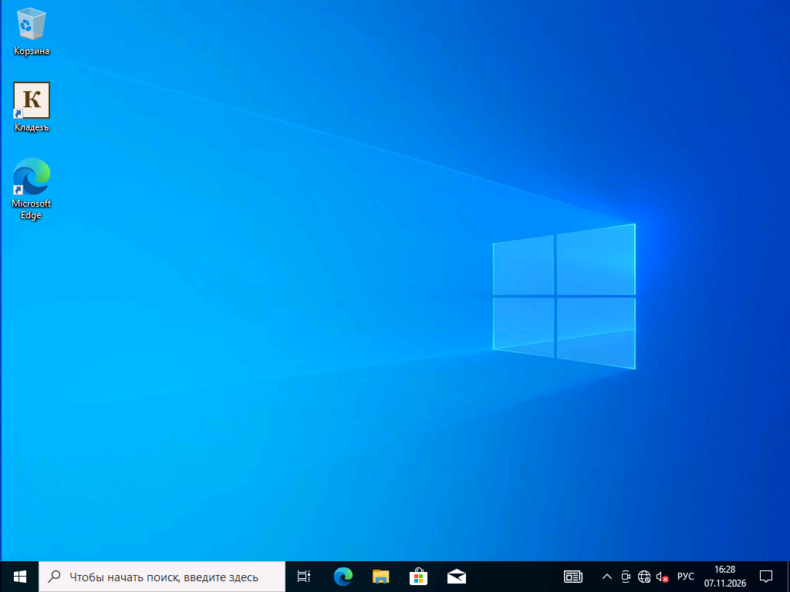

**[Картинка: окно установщика с полосой «Распаковываю программу…»]**

Может появиться окно **«Добро пожаловать в подсистему Windows для Linux»** — это служебное окно Windows. Его можно просто закрыть крестиком.

## Шаг 9. «Готово»

Когда всё закончится, появится окно **«Завершение Мастера установки Кладезъ»**. Галочка **«Открыть «Кладезъ» сейчас»** уже стоит. Нажмите **«Завершить»**.

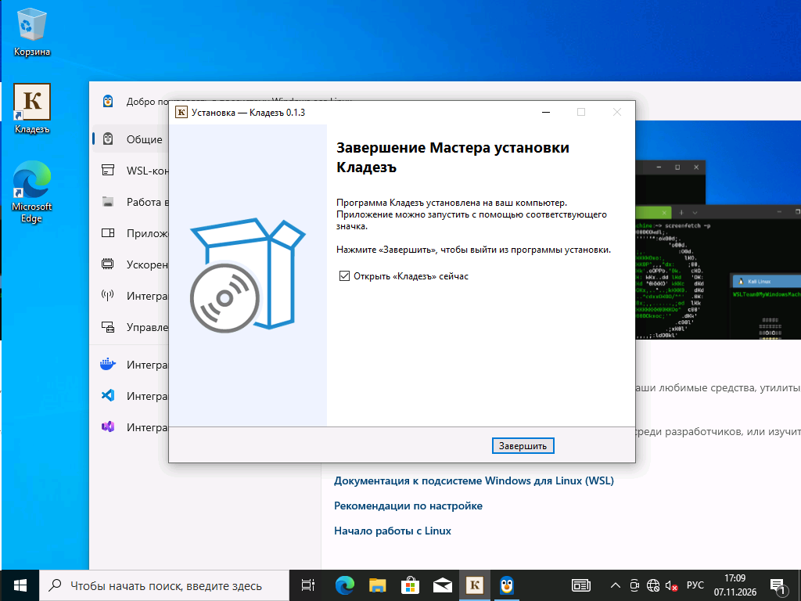

На рабочем столе теперь есть ярлык **«Кладезъ»**. В меню «Пуск» появилась папка «Кладезъ» с инструкциями и кнопкой «Собрать сведения для помощи».

## Шаг 10. Если Edge показывает своё приветствие

Если на компьютере ещё ни разу не открывали браузер Edge, сначала он покажет своё приветствие: **«Добро пожаловать в Microsoft Edge»**. Это не «Кладезъ», а сам Edge.

Нажмите **«Начать без данных»**. Edge может показать ещё пару окон с вопросами — везде можно выбирать «Продолжить без…», «Не сейчас» или «Подтвердить и продолжить». После этого откроется «Кладезъ».

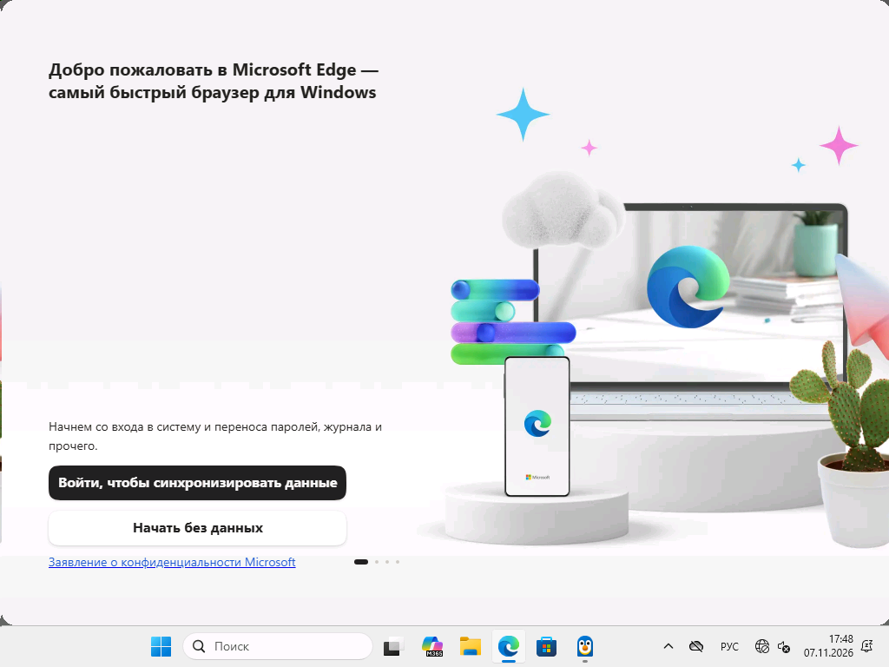

## Шаг 11. «Кладезъ» открылся

Вы увидите главную страницу «Кладезя»: плитки «Карты», «Быстрая настройка», «Склад программ», «Справка» и другие.

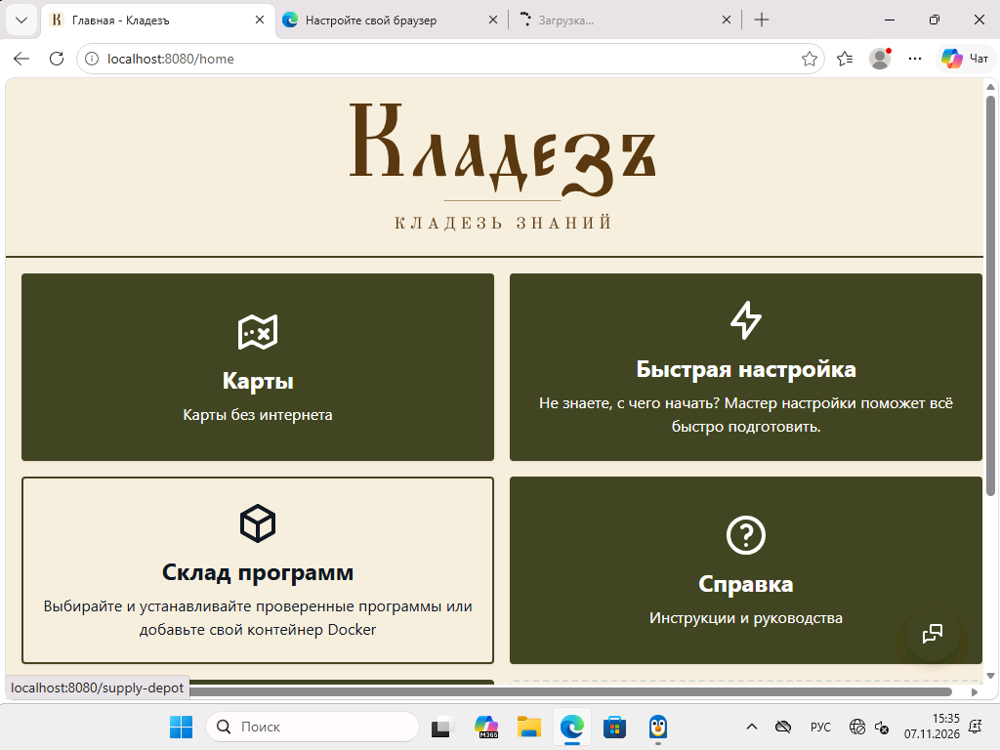

Если страница не открылась сразу — подождите пару минут: при первом запуске программа ещё готовится. Потом дважды щёлкните ярлык «Кладезъ» на рабочем столе.

## Шаг 12. Быстрая настройка — что скачать

Сейчас в библиотеке ещё ничего нет. Нажмите плитку **«Быстрая настройка»** и выберите готовый набор:

- **«Аптечка»** (около 5 ГБ) — самое нужное: медицина, популярные статьи Википедии, учебники;
- **«Библиотека»** (около 26 ГБ) — вся Википедия без картинок, учебники, словари, классика;
- **«Всё»** (около 62 ГБ) — вся Википедия с картинками и всё остальное.

**[Картинка: шаг «Материалы» Быстрой настройки с тремя наборами]**

Нажмите **«Далее»** до конца и **«Завершить настройку»**. Начнётся скачивание. Страницу можно закрыть, а если интернет пропадёт — скачивание продолжится, когда он вернётся.

Подробнее о каждом шаге — в «Справке» внутри «Кладезя».

---

## Как проверить, что файл настоящий

У каждого файла есть «отпечаток» — контрольная сумма. Если в файле изменить хоть один байт, отпечаток станет другим. Настоящий отпечаток опубликован рядом с установщиком в файле **SHA256SUMS.txt**.

1. Откройте папку **«Загрузки»**, где лежит установщик.
2. Нажмите на адресную строку папки (вверху, где написано «Загрузки»), сотрите текст, напишите `cmd` и нажмите **Enter**. Откроется чёрное окно.
3. Напишите в нём (вместо `0.1.3` — версия вашего файла):

   ```
   certutil -hashfile Кладезъ-установка-0.1.3.exe SHA256
   ```

   Имя файла можно не печатать целиком: напишите `certutil -hashfile Кла`, нажмите **Tab** — Windows допишет имя сама — и допишите ` SHA256`.
4. Нажмите **Enter**. Появится длинная строка из букв и цифр. Сравните её со строкой для этого файла в **SHA256SUMS.txt**. Совпадает — файл настоящий.

**[Картинка: чёрное окно с результатом certutil]**

## Если установщик просит включить виртуализацию

«Кладезю» нужна функция компьютера, которая называется **виртуализация**. Почти всегда она уже включена. Если нет, установщик скажет об этом и сам откроет пошаговую инструкцию с картинками. Её же можно открыть потом: «Пуск» → «Кладезъ» → «Как включить виртуализацию в BIOS».

Коротко:

1. Узнайте клавишу входа в BIOS — обычно **Del** или **F2** (HP — Esc, затем F10; Lenovo — F1 или F2).
2. Перезагрузите компьютер и, как только экран погаснет, часто нажимайте эту клавишу.

   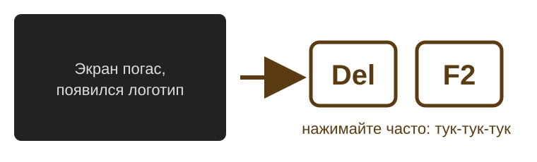

3. Найдите строку виртуализации — обычно в разделе **Advanced**. Для процессора Intel она называется **Intel Virtualization Technology** (или VT-x), для AMD — **SVM Mode** (или AMD-V). Поставьте **Enabled**.

   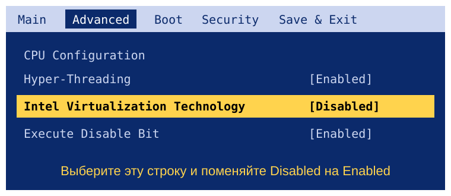

   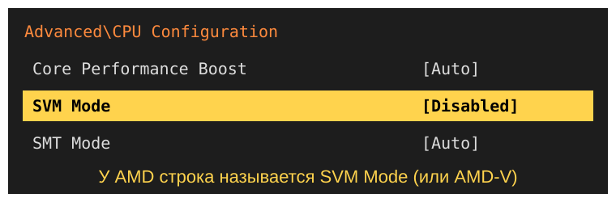

4. Нажмите **F10** и подтвердите **Yes** — компьютер сохранит настройку и перезагрузится.

   

5. Запустите установщик «Кладезя» ещё раз.

Это безопасно: вы меняете одну настройку, файлы и Windows не затрагиваются. Совет: распечатайте инструкцию или откройте её на телефоне — когда компьютер уйдёт в BIOS, экран с инструкцией пропадёт.

## Если файл пропал сразу после скачивания

Изредка Защитник Windows по ошибке убирает новый файл «на карантин». Если контрольная сумма совпадала (или вы скачивали с официальной страницы), файл можно вернуть:

«Пуск» → «Параметры» → «Обновление и безопасность» (в Windows 11 — «Конфиденциальность и защита») → «Безопасность Windows» → «Защита от вирусов и угроз» → «Журнал защиты» → строка с «Кладезъ-установка» → «Действия» → **«Восстановить»**.

## Если установка не получилась

- **Сначала перезагрузите компьютер и запустите установщик ещё раз.** Часто этого достаточно.
- Если пишет, что **заняты порты** — значит, работает другая похожая программа (например, Project NOMAD). Закройте её и запустите установку снова.
- Если не помогло — нажмите «Пуск» → «Кладезъ» → **«Собрать сведения для помощи»** (если папки ещё нет — пришлите файлы из `C:\ProgramData\Kladez\logs`). На рабочем столе появится файл «Кладезъ-сведения-…zip» — отправьте его тому, кто помогает вам с компьютером. В нём только журналы установки, без ваших личных файлов.

## Как удалить

«Пуск» → «Параметры» → «Приложения» → **«Кладезъ»** → «Удалить». Программа спросит, удалять ли скачанную библиотеку. Если оставить её, при повторной установке ничего не придётся скачивать заново.

---

«Кладезъ» — бесплатная программа с открытым кодом. Основан на Project NOMAD (Crosstalk Solutions), лицензия Apache-2.0. Программа ничего не сообщает о вас ни в какие службы.
